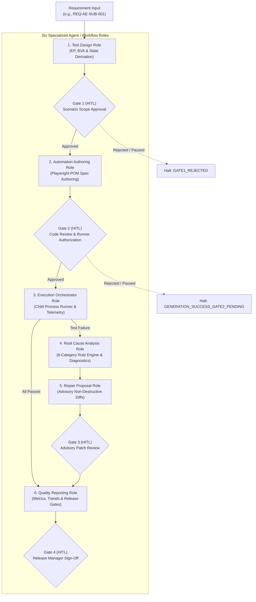

# AI Level-3 Quality Engineering Capstone

Enterprise end-to-end test automation and autonomous multi-agent quality engineering framework built with [Playwright](https://playwright.dev/) and TypeScript for the [Automation Exercise](https://automationexercise.com) platform.

---

## 1. Repository Information

- **Project**: AI Level-3 Quality Engineering Capstone (`qa-ai-level3`)
- **System Under Test (SUT)**: [https://automationexercise.com](https://automationexercise.com)
- **Active Branch**: `master`
- **Remote Repository URL**: **None configured**. Running `git remote -v` confirms that no remote Git origin or upstream URL is currently configured for this repository. All work resides in the local workspace.

---

## 2. Project Overview

This repository implements an **AI Level-3 Quality Engineering Capstone**, demonstrating the combination of structured Playwright + TypeScript test automation with an agentic testing and diagnostic workflow. The system automates functional UI and REST API suites using the Page Object Model (POM) pattern, complemented by a multi-role quality engineering pipeline designed to handle scenario generation, spec authoring, execution telemetry, failure diagnostics, advisory repair proposals, and release gating.

### Key Capabilities
- **Page Object Model (POM) Automation**: Resilient UI test suites featuring DOM-content-loaded navigation, targeted ad-block route aborts, row-ID-bound cart deletions, and web-first auto-waiting assertions.
- **Agentic Testing & RCA Lifecycle**: A structured workflow divided into six specialized agent/workflow roles, bound by deterministic governance and strict **Human-in-the-Loop (HITL)** approval gates.
- **Deterministic Fallback Provider**: Includes a built-in `ModelFreeFallbackProvider` that allows the pipeline to generate mapped test code, diagnose errors, and produce reports deterministically without calling external AI APIs.
- **Automated Root Cause Analysis (RCA)**: A rule-based 8-category failure classification engine that inspects error logs, Playwright traces, DOM snapshots, and network events to categorize test failures with calibrated confidence scores.
- **Controlled Fault Injection**: Dedicated fault-injection harness (`playwright.fault-injection.config.ts`) validating automated diagnostic classification of locator syntax errors (`FI-01`) and network connection resets (`FI-02`).

---

## 3. Architecture & Workflow Roles

The quality engineering lifecycle is partitioned across **six specialized agent/workflow roles** orchestrated by a central finite state machine. These roles represent modular phases within a coordinated quality engineering pipeline, **not** six independently running AI models.

For full architectural contracts, schemas, and state machine transitions, refer to [docs/architecture.md](docs/architecture.md).

### Workflow Architecture Diagram



### Role Responsibilities & Human Approval Gates

| Workflow Role | Source Module | Primary Responsibility | Human-in-the-Loop (HITL) Gate |
| :--- | :--- | :--- | :--- |
| **1. Test Design** | `tools/agents/testDesignAgent.ts` | Derives structured positive, negative, and boundary scenarios using Equivalence Partitioning (EP) and Boundary Value Analysis (BVA). | **Gate 1**: Human reviews and approves scenario scope prior to any code generation. |
| **2. Automation Authoring** | `tools/agents/automationAuthoringAgent.ts` | Translates approved scenarios into Playwright/TypeScript specs reusing existing Page Objects, web-first assertions, and AST syntax validation. | **Gate 2**: Human inspects generated code quality before authorizing test runner execution. |
| **3. Execution Orchestrator** | `tools/agents/orchestrator.ts`<br>`tools/agents/executionRunner.ts` | Manages state machine flow, spawns isolated child runner processes (`shell: false`), and injects unique execution tracking IDs (`AGENT_EXECUTION_ID`). | Governed by Gate 2 authorization. |
| **4. Root Cause Analysis** | `tools/agents/rcaAgent.ts`<br>`tools/rca/deterministicClassifier.ts` | Ingests Playwright execution facts and classifies failures into the standardized 8-category taxonomy with calibrated confidence scores. | Classification verified against deterministic rule heuristics. |
| **5. Repair Proposal** | `tools/agents/repairProposalAgent.ts` | Formulates surgical, non-destructive advisory code patches for script and locator defects without modifying source files. | **Gate 3**: Mandatory human review and approval required before applying any suggested patch. |
| **6. Quality Reporting** | `tools/agents/qualityReportingAgent.ts` | Compiles multi-run execution metrics, tracks historical reliability trends, and computes release readiness (`GO`, `NO_GO`, `CONDITIONAL_GO`). | **Gate 4**: Human release manager sign-off on executive recommendations. |

---

## 4. AI Provider Integration & Deterministic Fallback

The pipeline implements an extensible provider model managed by `ProviderFactory` (`src/agents/providers/providerFactory.ts`):

- **Implemented Provider Integrations**:
  - `GeminiProvider`: Implements integration with Google Gemini models using `GEMINI_API_KEY` (first priority).
  - `OpenAIProvider`: Implements integration with OpenAI models using `OPENAI_API_KEY` (second priority).
- **Deterministic `ModelFreeFallbackProvider` (Default)**:
  - When live API keys are not configured, the system automatically uses `ModelFreeFallbackProvider`.
  - For mapped demonstration requirements (such as `REQ-AE-SUB-001`), the fallback provider produces valid, executable Playwright test specs using pre-mapped Page Object references.
  - For unmapped requirements without pre-configured selectors, the fallback provider **never hallucinates locators**; it generates a `manual_review_<reqId>.md` file flagging the requirement for human feasibility analysis.
- **Operational Reality**: **Live LLM execution against external third-party AI APIs has not been verified** in this repository. All verified pipeline runs and demonstrations have executed using the deterministic `ModelFreeFallbackProvider`.

---

## 5. Prerequisites, Setup & Command Compatibility

### Prerequisites
- **Node.js**: `v18.x` or `v20.x` LTS
- **npm**: `v9.x` or higher
- **Operating System**: Windows (PowerShell / Command Prompt), macOS, or Linux
- **Target Browser**: Google Chrome (configured via `channel: 'chrome'` in `playwright.config.ts`)

### Installation & Setup

1. **Clone the repository and install dependencies**:
   ```bash
   npm install
   ```

2. **Install the Google Chrome browser binary for Playwright**:
   ```bash
   npx playwright install chrome
   ```

3. **Configure Environment Variables (Optional)**:
   Zero external API keys are required to execute tests or the multi-agent pipeline under the fallback provider. If testing live AI integrations, configure environment variables in your shell or a `.env` file:
   ```bash
   GEMINI_API_KEY=your_gemini_api_key_here
   OPENAI_API_KEY=your_openai_api_key_here
   ```

### Windows PowerShell Compatibility Note

On Windows systems where PowerShell ExecutionPolicy restricts running `.ps1` wrapper scripts, standard `npm` and `npx` commands may fail with an execution policy error. You can run the `.cmd` counterparts directly:

```powershell
# Use .cmd executables if PowerShell execution policy blocks .ps1 wrappers
npm.cmd test
npx.cmd playwright test
npx.cmd tsx tools/agents/runPipeline.ts --approve-all
```

Alternatively, bypass the restriction for the current PowerShell session:
```powershell
Set-ExecutionPolicy -Scope Process -ExecutionPolicy Bypass
```

---

## 6. Available npm Commands

All primary tasks are exposed via scripts in [package.json](package.json):

| Command | Exact Script Invocation | Purpose & Description |
| :--- | :--- | :--- |
| `npm test` | `playwright test` | Runs the full Playwright test suite in headless mode. |
| `npm run test:ui` | `playwright test --ui` | Launches Playwright's interactive visual UI Mode with time-travel debugging. |
| `npm run test:headed` | `playwright test --headed` | Runs Playwright tests using visible, headed browser windows. |
| `npm run report` | `playwright show-report` | Starts a local web server serving the interactive Playwright HTML report. |
| `npm run agents:pipeline` | `tsx tools/agents/runPipeline.ts` | Executes the autonomous multi-agent pipeline with default settings (pauses at Gate 1 for scenario review). |
| `npm run test:fi` | `playwright test --config=playwright.fault-injection.config.ts` | Runs both controlled fault-injection scenarios (`FI-01` and `FI-02`). |
| `npm run test:fi:01` | `playwright test tools/fault-injection/fi01_test_script_defect.spec.ts --config=playwright.fault-injection.config.ts` | Runs the `FI-01` controlled test script syntax defect exercise. |
| `npm run test:fi:02` | `playwright test tools/fault-injection/fi02_network_failure.spec.ts --config=playwright.fault-injection.config.ts` | Runs the `FI-02` controlled network connection reset failure exercise. |

### Targeted CLI Execution Examples

```powershell
# Run Cart UI suite (6 tests, single worker)
npx playwright test tests/ui/cart.spec.ts --project="Google Chrome" --workers=1

# Run Product Catalog UI suite (4 tests)
npx playwright test tests/ui/product.spec.ts --project="Google Chrome" --workers=1

# Run Authentication UI suite (3 tests)
npx playwright test tests/ui/auth.spec.ts --project="Google Chrome" --workers=1

# Run REST API suite (6 tests, 20+ assertions)
npx playwright test tests/api/api.spec.ts --project="Google Chrome" --workers=1

# Run Agent Unit & Governance Validation suites (58 tests)
npx playwright test tests/rca/ tests/agents/ --workers=1

# Execute Multi-Agent Pipeline granting both Gate 1 and Gate 2 approval
npx tsx tools/agents/runPipeline.ts --approve-all

# Execute Pipeline in authoring-only mode (skip browser execution)
npx tsx tools/agents/runPipeline.ts --approve-all --skip-execution

# Inspect a recorded execution trace
npx playwright show-trace test-results/<test-folder>/trace.zip
```

---

## 7. Test Organization & Coverage Status

### Directory Layout

```
tests/
├── ui/                                # Hand-crafted end-to-end UI suites (13 tests)
│   ├── auth.spec.ts                   # User authentication & registration (3 tests)
│   ├── cart.spec.ts                   # Cart operations, calculations & persistence (6 tests)
│   └── product.spec.ts                # Catalog browsing & search validations (4 tests)
├── generated/                         # Pipeline-generated test specs (3 tests)
│   └── generated_req_ae_sub_001.spec.ts # Newsletter subscription specs via fallback provider (3 tests)
├── api/                               # REST API integration test suite (6 tests, 20+ checks)
│   └── api.spec.ts                    # Backend API contracts & account CRUD
├── rca/                               # Failure classification & repair unit tests (33 tests)
│   ├── deterministicClassifier.spec.ts # Rule-based 8-category classification tests (24 tests)
│   └── repairProposalAgent.spec.ts     # Advisory patch generation & invariant tests (9 tests)
├── agents/                            # Quality governance unit tests (25 tests)
│   └── qualityReportingAgent.spec.ts   # Release decision matrix & degradation tests (25 tests)
└── example.spec.ts                    # Starter smoke spec
tools/
└── fault-injection/                   # Controlled failure injection harness (2 tests)
    ├── fi01_test_script_defect.spec.ts # Syntactically invalid locator injection
    └── fi02_network_failure.spec.ts    # Aborted route network connection injection
```

### Current Test Coverage Breakdown

- **Executable UI Tests**: **16 implemented tests** across 4 functional areas:
  - **13 hand-crafted UI tests** in `tests/ui/`: `AUTH` (3), `PROD` (4), `CART` (6).
  - **3 pipeline-generated UI tests** in `tests/generated/`: `ENG` newsletter (3).
  - *Coverage Target Status*: The capstone target of **18+ UI test scenarios across 6 functional areas is not yet fully met**. The current gap is a minimum of **2 additional UI scenarios** and **2 additional functional areas** (`CHECK` and `INT`).
- **REST API Suite**: **6 test cases and 20+ assertions/checks** in `tests/api/api.spec.ts`, covering response schemas, status codes, query parameters, method restrictions, and a complete user account CRUD lifecycle. This count is separate from the UI suite count.
- **Agent Governance & RCA Unit Suites**: **58 tests** verifying failure classification heuristics, repair proposal invariants, and release decision rules.
- **Verification Notice**: While all test files exist and are syntax-validated in the repository, previous test passes represent historical execution records. In any newly cloned or reset environment, passing execution must be verified by running the test commands.

### Functional Areas Status

1. **User Authentication & Account Management (`AUTH`)**: Implemented (3 UI tests in `tests/ui/auth.spec.ts`).
2. **Product Catalog & Search (`PROD`)**: Implemented (4 UI tests in `tests/ui/product.spec.ts`).
3. **Cart Management & Computations (`CART`)**: Implemented (6 UI tests in `tests/ui/cart.spec.ts`).
4. **Customer Engagement (`ENG`)**: **Partially covered** (3 pipeline-generated UI tests for newsletter subscription in `tests/generated/generated_req_ae_sub_001.spec.ts`; Contact Us with attachment upload and Product Review remain unautomated).
5. **Backend REST APIs (`API`)**: Implemented (6 API tests in `tests/api/api.spec.ts`).
6. **Checkout, Order Processing & Invoicing (`CHECK`)**: **Missing / Not Implemented** (0 tests).
7. **Hybrid UI/API Integration (`INT`)**: **Missing / Not Implemented** as a standalone suite (0 dedicated tests; hybrid patterns exist within `cart.spec.ts`).

### Tags & Filter Annotations

- `@smoke`: Critical functional paths across authentication, catalog, cart, and APIs.
- `@negative`: Negative validation checks (invalid credentials, missing parameters, nonexistent search queries).
- `@edge` / `@boundary`: Boundary value checks (quantities `0` and `-1`, whitespace query strings).
- `@auth`, `@prod`, `@cart`, `@api`, `@generated`: Domain-specific functional area tags.
- `@REQ-AE-*`: Bidirectional traceability tags connecting specs to requirements (e.g., `@REQ-AE-CART`, `@REQ-AE-AUTH`, `@REQ-AE-SUB-001`).
- `@fault-injection`, `@fi01`, `@fi02`: Fault-injection harness tags.

#### Informational Annotations
- `cleanup_warning`: Appended dynamically in teardown blocks if backend API test account cleanup encounters an issue, preventing teardown warnings from masking assertion outcomes.
- `observed_behavior`: Records runtime SUT nuances where application behavior deviates from strict specifications without throwing unhandled exceptions.

### Standardized 8-Category RCA Taxonomy

1. `PRODUCT_DEFECT`: SUT behavior deviated from specification (e.g., HTTP 500, incorrect price calculation).
2. `TEST_SCRIPT_DEFECT`: Defect in test implementation (e.g., malformed locator syntax, unhandled async promise).
3. `LOCATOR_OR_UI_CHANGE`: DOM altered legitimately, causing valid selector timeout.
4. `TEST_DATA_OR_STATE`: Dirty database state, email collision, or missing seed data.
5. `ENVIRONMENT_OR_NETWORK`: SUT downtime, DNS failure (`net::ERR_NAME_NOT_RESOLVED`), or TCP reset (`net::ERR_CONNECTION_RESET`).
6. `TIMING_OR_FLAKINESS`: Race conditions, slow animations, or delayed asynchronous DOM rendering.
7. `THIRD_PARTY_DEPENDENCY`: External integrations failing (e.g., Google Ads banner blocking UI clicks).
8. `UNKNOWN`: Unclassified failure or ambiguous error requiring human review.

---

## 8. CI/CD Configuration & Status

Continuous integration is configured via GitHub Actions in [.github/workflows/playwright.yml](.github/workflows/playwright.yml):

### Configured Workflow Specification
- **Triggers**:
  - `push` on branches `[ main, master ]`
  - `pull_request` on branches `[ main, master ]`
- **Runner OS**: `ubuntu-latest`
- **Execution Timeout**: 60 minutes
- **Pipeline Steps**:
  1. Repository checkout (`actions/checkout@v4`).
  2. Node.js setup (`actions/setup-node@v4` with `node-version: lts/*`).
  3. Clean dependency installation (`npm ci`).
  4. Playwright browser installation (`npx playwright install --with-deps`).
  5. Test execution (`npx playwright test`).
  6. HTML report artifact upload (`actions/upload-artifact@v4` storing `playwright-report/` for 30 days, running `if: ${{ !cancelled() }}`).

### Known CI Limitations & Verification Status
- **Browser Channel Mismatch**: `playwright.config.ts` specifies `channel: 'chrome'` (Google Chrome), while the workflow executes `npx playwright install --with-deps` (which installs open-source Chromium). On standard Ubuntu GitHub Actions runners, this will cause Playwright to fail looking for Google Chrome unless branded Chrome is explicitly installed (`npx playwright install chrome --with-deps`) or the configuration falls back to Chromium on Linux CI.
- **Scheduled CI Pending**: No `schedule:` cron trigger is currently configured in the workflow file. Daily scheduled execution is pending configuration.
- **Unverified CI Execution**: Because no remote Git repository URL is configured (`git remote -v` has no remote), **CI execution on GitHub Actions has not been triggered or verified**. The workflow file represents a committed configuration, not an active or passing CI pipeline.

---

## 9. Known Limitations & Acceptance Gaps

The following known limitations and incomplete criteria are confirmed for this repository:

1. **UI Scenario Count Gap**: Current UI automation contains **16 executable tests** (13 hand-crafted + 3 pipeline-generated), falling short of the 18-test requirement by at least **2 test scenarios**.
2. **Functional Area Gaps**: 4 functional areas are covered (`AUTH`, `PROD`, `CART`, and partially `ENG`), leaving **2 functional areas completely unautomated**:
   - Area 4: `CHECK` (Checkout, Order Processing & Invoicing - 0 tests).
   - Area 7: `INT` (Hybrid UI/API Integration standalone spec - 0 tests).
   - Area 5: `ENG` (Customer Engagement) is only partially automated (newsletter subscription covered; Contact Us file upload and Product Review remain unautomated).
3. **Unverified Live LLM Connectivity**: Implemented providers (`GeminiProvider`, `OpenAIProvider`) have not been verified against live external API endpoints. All verified pipeline runs have used the deterministic fallback provider.
4. **CI Browser Compatibility**: The Linux CI workflow installs Chromium, while `playwright.config.ts` specifies `channel: 'chrome'`, creating a known failure condition on Ubuntu runners.
5. **Consecutive Clean Smoke Runs**: Three consecutive recorded clean smoke runs have not been executed and documented as a formal stability verification gate.
6. **Fresh API Execution Verification**: The REST API suite contains 6 implemented tests with 20+ checks, but a fresh passing execution run was not verified during the latest audit.
7. **No Configured Git Remote**: The repository has no configured remote URL, preventing automated CI triggers and remote collaboration until a remote is added.

---

## 10. Generated Reports & Artifacts Reference

All pipeline, quality, and diagnostic artifacts are written to structured subdirectories under `reports/`:

| Artifact Category | Path | Purpose & Description |
| :--- | :--- | :--- |
| **Executive Dashboard** | `reports/quality-summary.md` | Primary release readiness report with pass rate trends, failure clusters, and release recommendations (`GO` / `NO_GO` / `CONDITIONAL_GO`). |
| **Pipeline Run Reports** | `reports/pipeline/<pipelineId>-<reqId>-report.md` | Step-by-step audit trail of multi-agent pipeline executions. |
| **Scenario Specifications** | `reports/scenarios/<reqId>-scenarios.json` | Structured scenarios generated by Agent 1 from requirement inputs. |
| **Authoring Summaries** | `reports/generation/<reqId>-summary.md` | Code authoring metrics, Page Object re-use stats, and AST balance checks. |
| **RCA Diagnostic Reports** | `reports/rca/rca-report-*.json` | Machine-readable failure diagnostics with 8-category classification and confidence scores. |
| **Repair Proposals** | `reports/proposals/proposal-*.md` | Advisory remediation diffs and risk assessments produced by Agent 5. |
| **Playwright HTML Report** | `playwright-report/index.html` | Interactive Playwright test execution report (`npm run report`). |

---

## 11. Documentation & Reference Links

- [docs/architecture.md](docs/architecture.md): Comprehensive system architecture, multi-agent contracts, state transitions, and governance models.
- [docs/ai-artifacts.md](docs/ai-artifacts.md): AI skill contracts, 5 human interventions, security sanitization, and governance pack (PDF available at `docs/ai-artifacts.pdf`).
- [docs/test-scenarios.md](docs/test-scenarios.md): 24-scenario test design catalogue spanning all functional areas.
- [docs/security.md](docs/security.md): Data sanitization, credential redaction, and prompt injection defense specifications.
- [docs/traceability.md](docs/traceability.md): Bidirectional traceability matrix connecting requirements, test cases, and execution results.
- [HANDOVER.md](HANDOVER.md): Master technical handover document detailing implementation status, recent verification evidence, and environment setup.
